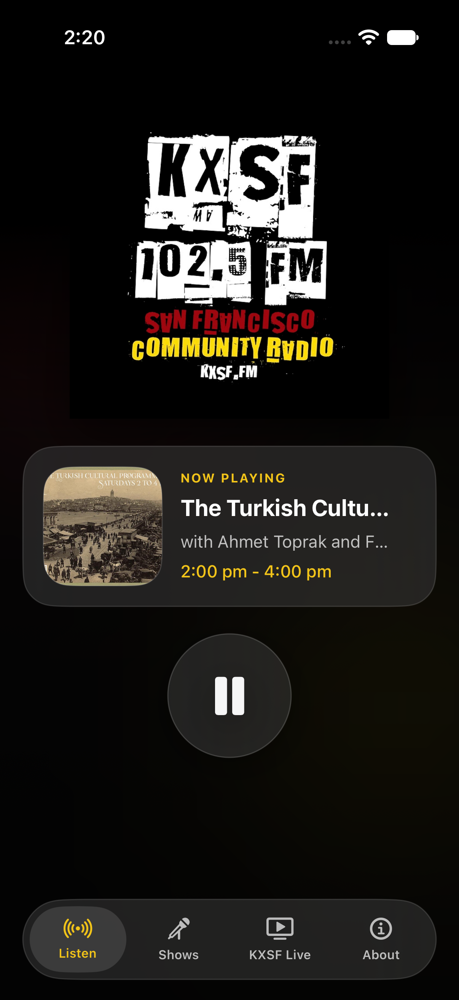
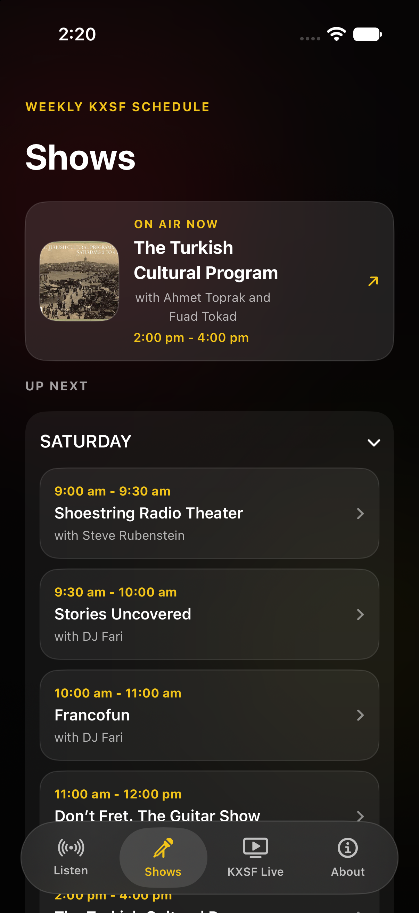
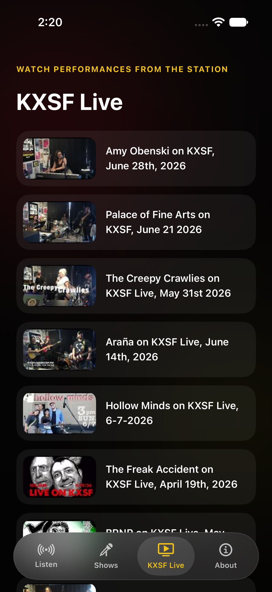

# KXSF.FM (San Francisco Community Radio iOS app)

Listen to KXSF 102.5 FM, see what's on, and explore the station's programming from your iPhone.

[View on the App Store](https://apps.apple.com/us/app/kxsf-fm/id1635505876) · [Read the case study](https://iahmedot.com/case-studies/kxsf/) · [Visit KXSF](https://kxsf.fm/)

## Why the app exists

The first KXSF app gave listeners a way to open the live stream. After launch, the station shared feedback that people wanted more context: which show was playing, who was hosting, and what else was on the schedule.

Version 2 brings that information into the listening experience. It gives listeners one place to tune in, discover shows, browse station videos, and find ways to support San Francisco Community Radio.

## The listening experience

- **Listen:** Play the live broadcast and see current-show information when the station provides it. Audio can continue in the background.
- **Shows:** Browse the weekly schedule, read available host information, and open official show pages.
- **KXSF Live:** Browse recent videos from the station's official YouTube channel.
- **About:** Find station information, social links, the KXSF website, and its donation page.
- **Widgets and Live Activities:** Keep playback and show information close at hand outside the app.

<p>
  
  
  
</p>

## How the app was built

KXSF V2 is a native SwiftUI rebuild of the earlier iOS app. `AVPlayer` handles the radio stream, while WidgetKit and ActivityKit bring playback and show information to system surfaces.

The station's show information was available on its website, but not through a clean content API. The app retrieves official pages and parses the schedule, show details, and available artwork. YouTube page parsing supplies the video list. Parsing lives in the `KXSFCore` Swift package, separate from the screens and player.

Working with that content meant accounting for missing information. Host credits appear only when supplied by the station. If show artwork is missing or invalid, the app uses the KXSF logo. Retries and a last-known-good video cache help handle temporary content failures.

Ahmed AlOtaibi built KXSF V2 using development tools, including an AI assistant. Station feedback informed the work, and testing combined automated core and UI tests with checks on his iPhone. Comparing Simulator results with the physical device helped distinguish app defects from Simulator discrepancies.

The [full case study, “Making KXSF Easier to Tune In,”](https://iahmedot.com/case-studies/kxsf/) covers the listener feedback, source-data challenges, artwork fallback, and real-device testing behind the app.

## Explore the source

- `App/Sources/`: SwiftUI screens, playback, content loading, and app coordination.
- `App/Shared/`: Shared playback state and artwork handling.
- `App/LiveActivity/`: Widgets and Live Activities.
- `Sources/KXSFCore/`: Parsers, models, retry behavior, and cache policies.
- `Tests/KXSFCoreTests/` and `App/UITests/`: Core and interface regression tests.

To explore locally, use macOS, Xcode with a compatible iOS Simulator, and [XcodeGen](https://github.com/yonaskolb/XcodeGen). The app's deployment target is iOS 18.0 or later.

```bash
xcodegen generate
open KXSF.xcodeproj
```

Run the core tests with:

```bash
swift test
```

## License and station content

The application code is available under the [MIT License](LICENSE). KXSF's name, artwork, broadcasts, schedule information, and videos belong to their respective owners. Station content is retrieved from official sources.
